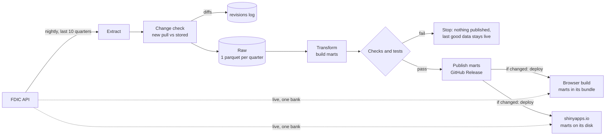

# Data pipeline

A nightly job pulls every bank's quarterly filings from the FDIC API, stores
them as one parquet file per quarter (**raw**), and builds small finished
tables (**marts**) that the app reads. Single-bank histories are the one
thing the app still fetches live from the FDIC API.



## Pieces

| Piece | File |
|---|---|
| Extract, change check, raw, marts, mart checks | `pipeline/build.R` |
| Nightly run, upload, deploy trigger | `.github/workflows/pipeline.yml` |
| Download marts before test and deploy | `.github/workflows/deploy.yml` |
| App reads the marts | `app/R/data.R` (`load_snapshot`, `load_industry`) |

The failures panel (`app/data/fail_panel.rds`) is not part of this
pipeline yet. It is rebuilt monthly by `.github/workflows/refresh.yml` and
committed to git.

## Words

- **Raw**: what FDIC sent, untouched. One file per quarter, every bank.
- **Mart**: a finished table built for one screen or chart, already
  filtered, joined and summed. The app reads marts and does no heavy math.
- **Revision**: a value FDIC changed in a quarter we had already pulled.

## Steps

1. **Extract.** Find the newest complete quarter (at least 95% as many
   banks as the quarter before), then pull the last 10 quarters. One request
   returns every bank for a quarter; pages past the API's 10,000-row cap.
2. **Change check.** Compare each new pull with the stored file, keyed by
   CERT. Every changed value, plus banks that appeared or disappeared, is
   appended to `revisions.csv`. The app does not use the log; it is an
   audit trail of FDIC restatements.
3. **Raw.** Overwrite the quarter's parquet file with the new pull.
4. **Transform.** Build the marts from all raw files on hand, plus one
   request for the FDIC directory of active banks.
5. **Checks.** `build.R` checks the marts (bank counts, no duplicates,
   assets = liabilities + equity for the industry, no quarter losing more
   than 10% of banks, no missing quarters, every field covered in the last
   10 quarters, every summed field matching FDIC's own aggregate API, Q1
   net income and charge-offs = year to date, net loans + allowance =
   gross loans, and each charted industry ratio inside wide bounds that
   catch unit or sum errors). The workflow then runs the app's smoke and integrity
   tests against them. Any failure stops the run: nothing is uploaded and
   the last good data stays live.
6. **Publish.** Upload the quarters pulled this run, `manifest.csv` and
   `revisions.csv` to the `data-raw` release. If any mart changed
   (byte comparison with the published copy), upload the marts to
   `data-marts` and start the deploy. Most nights nothing changed and
   nothing deploys.

## Marts

| Mart | One row per | Used for |
|---|---|---|
| `industry_quarterly` | quarter, every `STATEMENT_FIELDS` field summed (NA where `field_coverage` is below `COVERAGE_MIN`): the statement lines plus the numerators and denominators of the "All banks" chart lines | Industry tab: table and charts; industry lines on the metric charts |
| `field_coverage` | quarter × statement field: banks reporting it and their share of assets | Audit of gaps; the checks in `build.R` |
| `latest_snapshot` | bank in the newest quarter, plus active banks that have not filed yet | Peer bands (banks that filed) and the bank picker (`active` banks) |

`latest_snapshot` has an `active` flag because "banks in the latest
quarter" is not the same as "active banks": the quarter includes clearing
houses, trust-only charters and banks that closed after quarter end, and a
newly chartered bank is active before its first filing.

`industry_quarterly` covers every raw quarter on hand, back to 1984 Q1
once the one-time backfill has run (`quarters = 171` on the workflow; see
`docs/specs/industry-history.md`).

Planned: `peer_bands_quarterly` (historical peer bands) and `fail_panel`
moved into this pipeline.

## Storage

| What | Where | Why |
|---|---|---|
| Raw, `manifest.csv`, `revisions.csv` | GitHub Release `data-raw` | Free, up to 2 GB per file, kept out of git history so the repo does not grow |
| Marts | GitHub Release `data-marts` | Same |
| Marts for the browser build | Downloaded into `app/data/` at deploy, bundled into `app.json` | Small (about 2 MB); same code path as shinyapps.io |
| Marts for shinyapps.io | Downloaded into `app/data/` at deploy, shipped in its bundle | See below |

**Why each site carries its own copy.** Neither site reads the marts from
anywhere at runtime: each deploy downloads them once and ships them inside
the site. So the two sites are each other's backup: if Pages or the
browser build is down, shinyapps.io still works, and the reverse. Both
deploys come from the same pipeline run, so their numbers match.

If GitHub Releases ever gets too slow or limited, move raw and marts to
Cloudflare R2. Only the download and upload commands change.

## Decisions

| Topic | Decision |
|---|---|
| Single-bank histories | Stay live from the FDIC API |
| Revision window | Re-check the last 10 quarters every night |
| Parquet reader | `nanoparquet` (small, works in the browser). Not `duckdb`: 9.4 MB extra download in the browser |
| Database server | None. Static files on GitHub are the store |

## API etiquette

Never loop over banks; loop over quarters. One request at a time, at least
2 seconds apart. On failure, retry after 10 s, 30 s, then 90 s, then stop
the run without publishing. A nightly run is 14 requests and takes about
2 minutes.

## Running it locally

From the repo root. To run the app, you only need the published marts:

```
gh release download data-marts --dir app/data --clobber
```

To build the marts yourself:

```
Rscript pipeline/build.R        # last 10 quarters
Rscript pipeline/build.R 40     # last 40 quarters
cp pipeline/out/marts/*.parquet app/data/
```

Output goes to `pipeline/out/` (gitignored):

| Path | Contents |
|---|---|
| `raw/risdate.YYYYMMDD.parquet` | Every bank for one quarter: the app's fields plus CITY |
| `raw/manifest.csv` | One row per quarter pulled: bank count, file size, md5, changes found |
| `revisions.csv` | Appended log of values FDIC changed since the last pull |
| `marts/*.parquet` | The marts |

A local run compares against whatever raw files are already in
`pipeline/out/raw/`, not the published ones. To continue from the
published history, download it first:
`gh release download data-raw --dir pipeline/out/raw --pattern 'risdate.*.parquet'`.

The script reuses the app's own API client (`app/R/api.R`) and
`industry_totals()` (`app/R/statements.R`), so its numbers match the app.
Needs the `nanoparquet` package.
