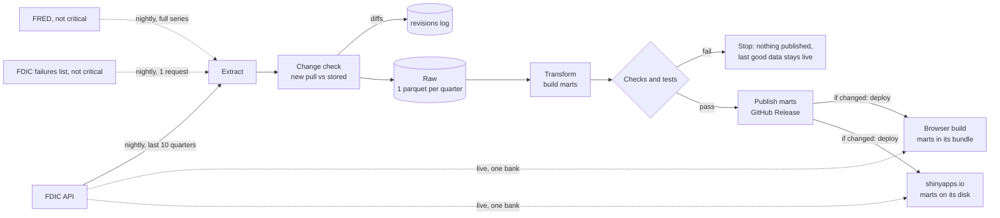

# Data pipeline

A nightly job pulls every bank's quarterly filings from the FDIC API, stores
them as one parquet file per quarter (**raw**), and builds small finished
tables (**marts**) that the app reads. It also pulls the FDIC failures list
(for the failures tab) and a few FRED rate series (for `hidden_loss` and
other research marts), and values the HMDA loan groups a yearly job stores;
see [Sources](#sources). Single-bank histories are the one thing the app
still fetches live from the FDIC API.



## Pieces

| Piece | File |
|---|---|
| Entry point: runs the steps below in order | `pipeline/build.R` |
| Throttled transport (2 s gap per host, retries, request count) | `pipeline/R/http.R` |
| Raw store: quarter files, change check, manifest, revisions log | `pipeline/R/store.R` |
| Source registry, non-critical failure handling | `pipeline/R/sources.R` |
| Extract: FDIC quarters to pull, one quarter per request (paged) | `pipeline/sources/fdic.R` |
| Extract: FRED series, pull check, diff, store | `pipeline/sources/fred.R` |
| Extract: FDIC failures list, pull check, diff, store | `pipeline/sources/failures.R` |
| One-time static source, run by hand: Fed BTFP borrowers (not in the nightly run) | `pipeline/sources/btfp.R` -> `pipeline/static/` |
| Yearly source in its own workflow: HMDA national snapshot (not in the nightly run) | `pipeline/sources/hmda.R`, `.github/workflows/hmda.yml` |
| Estimators: pure functions, data frames in and out (shared with research) | `pipeline/R/hidden_loss.R`, `pipeline/R/run_stress.R`, `pipeline/R/hmda_book.R` (HMDA filter, lender links, groups, and the nightly valuation `hb_value()`) |
| Marts: `industry_quarterly` + `field_coverage`, `latest_snapshot`, `rates_monthly`, `fail_panel` + `failures_meta`, `research_field_coverage`, `bank_ids`, `hidden_loss` + `hidden_loss_history`, `run_stress`, `hmda_book` | `pipeline/marts/industry.R`, `pipeline/marts/snapshot.R`, `pipeline/marts/rates.R`, `pipeline/marts/fail_panel.R`, `pipeline/marts/research_coverage.R`, `pipeline/marts/bank_ids.R`, `pipeline/marts/hidden_loss.R`, `pipeline/marts/run_stress.R`, `pipeline/marts/hmda_book.R` |
| Mart checks, one file per mart (plus the `check()` helper) | `pipeline/checks/industry.R`, `pipeline/checks/snapshot.R`, `pipeline/checks/rates.R`, `pipeline/checks/fail_panel.R`, `pipeline/checks/research_coverage.R`, `pipeline/checks/bank_ids.R`, `pipeline/checks/hidden_loss.R`, `pipeline/checks/run_stress.R`, `pipeline/checks/hmda_book.R`, `pipeline/checks/check.R` |
| Offline golden tests of the pure functions (fixtures cut from raw in `tests/fixtures/`) | `pipeline/tests/run.R` (CI: `.github/workflows/pipeline-test.yml`) |
| Nightly run, upload, deploy trigger | `.github/workflows/pipeline.yml` |
| Download marts before test and deploy | `.github/workflows/deploy.yml` |
| App reads the marts | `app/R/data.R` (`load_snapshot`, `load_industry`, `load_fail_panel`, `load_fail_meta`) |

## Words

- **Raw**: what FDIC sent, untouched. One file per quarter, every bank.
- **Mart**: a finished table built for one screen or chart, already
  filtered, joined and summed. The app reads marts and does no heavy math.
- **Revision**: a value FDIC changed in a quarter we had already pulled.

## Steps

1. **Extract.** Find the newest complete quarter (at least 95% as many
   banks as the quarter before), then pull the last 10 quarters. One request
   returns every bank for a quarter; pages past the API's 10,000-row cap.
2. **Change check.** Compare each new pull with the stored file, keyed by
   CERT. Every changed value, plus banks that appeared or disappeared, is
   appended to `revisions.csv`. The app does not use the log; it is an
   audit trail of FDIC restatements. A column only one side has (the
   field list changed) is one `<schema>` row for the quarter (CERT empty,
   `old` = columns dropped, `new` = columns added), and its values are not
   compared, so widening the raw files logs 171 rows, not millions.
3. **Raw.** Overwrite the quarter's parquet file with the new pull.
4. **Transform.** Build the marts from all raw files on hand, plus one
   request for the FDIC directory of active banks.
5. **Checks.** `pipeline/checks/` checks the marts (bank counts, no duplicates,
   assets = liabilities + equity for the industry, no quarter losing more
   than 10% of banks, no missing quarters, every field covered in the last
   10 quarters, every summed field matching FDIC's own aggregate API, Q1
   net income and charge-offs = year to date, net loans + allowance =
   gross loans, and each charted industry ratio inside wide bounds that
   catch unit or sum errors). The workflow then runs the app's smoke and integrity
   tests against them. Any failure stops the run: nothing is uploaded and
   the last good data stays live.

   **Auto-heal.** FDIC occasionally accepts amended filings for quarters
   older than the 10-quarter window, so a stored quarter stops matching
   FDIC's aggregate. Before the checks, `stale_quarters()`
   (`pipeline/checks/industry.R`) asks for the aggregate once. If every
   quarter that disagrees is a stored one this run did not pull, and there
   are at most `HEAL_MAX` (8), `build.R` re-pulls them, logs their revisions
   and rebuilds the marts. The checks then run as usual. If a quarter
   pulled this run disagrees, or more than 8 are stale, or a re-pulled
   quarter still disagrees, the run fails as before.
6. **Publish.** Upload the quarters pulled this run, `manifest.csv`,
   `revisions.csv` and the `fred.*` and `failures.*` files written this run to the
   `data-raw` release. If any mart changed (byte comparison with the
   published copy), upload the marts to `data-marts`, and start the deploy
   if one the app reads changed. The marts the app does not read
   (`NO_DEPLOY` in `pipeline.yml`: `rates_monthly`, `research_field_coverage`,
   `bank_ids`, `hidden_loss`, `hidden_loss_history`, `run_stress`, `hmda_book`) never start a deploy.
   Most nights nothing changed and nothing deploys.

Steps 1 to 3 run for each source in the registry (`pipeline/R/sources.R`),
FDIC first. What a failure does depends on what failed:

| What fails | What happens |
|---|---|
| FDIC request or check, or a core mart's check (`industry_quarterly`, `field_coverage`, `latest_snapshot`) | Run stops, nothing is published |
| FRED request or pull check | FRED keeps its last good raw files (downloaded from the release). `rates_monthly`, `hidden_loss` and `run_stress` are rebuilt from them while they are under 10 days old, and skipped after that, so the published copies stay. FDIC publishes. `build.R` exits with status 2 and the job fails at the end, so GitHub emails |
| Failures request or pull check | Same as FRED: the stored `failures.*` files stay, and `fail_panel` is rebuilt from them while they are under 35 days old (the old monthly refresh was never fresher), skipped after that |
| Stored HMDA groups missing or without the group columns (the `hmda` source pulls nothing at night: it checks the `hmda.groups.parquet` downloaded from the release) | `hmda_book` is skipped (its published copy stays). FDIC publishes. Job fails at the end |
| `rates_monthly`, `fail_panel`, `research_field_coverage`, `bank_ids`, `hidden_loss`, `run_stress` or `hmda_book` check | That mart is not published (its old copy stays). `failures_meta` is held back with `fail_panel`, and `hidden_loss_history` with `hidden_loss`, so each pair always matches. `hidden_loss` and `hmda_book` read tonight's `rates_monthly`, and `run_stress` tonight's `hidden_loss`, so each fails when the one it reads did. The others publish. Job fails at the end |

`fail_panel` is built on a non-critical source, so it is not a core mart:
its failure never blocks `industry_quarterly` or `latest_snapshot`, and
the failures tab keeps showing the last good panel. A mart skipped or
held back tonight is smoke-tested as its published copy, since that copy
is what the deploy ships.

## Marts

| Mart | One row per | Used for |
|---|---|---|
| `industry_quarterly` | quarter, every `STATEMENT_FIELDS` field summed (NA where `field_coverage` is below `COVERAGE_MIN`): the statement lines plus the numerators and denominators of the "All banks" chart lines | Industry tab: table and charts; industry lines on the metric charts |
| `field_coverage` | quarter × statement field: banks reporting it and their share of assets | Audit of gaps; the checks in `pipeline/checks/` |
| `latest_snapshot` | bank in the newest quarter, plus active banks that have not filed yet | Peer bands (banks that filed) and the bank picker (`active` banks) |
| `rates_monthly` | FRED series × month: `avg`, `last`, `n_obs`, `n_missing` (blank days), `complete` (FALSE for the month to date), `method_break` | Input to `hidden_loss` and `hmda_book`. Not read by the app yet |
| `fail_panel` | (CERT, quarter) for the 0-20 quarters before each failure: the `APP_FIELDS` columns from raw, plus `label`, `fail_date`, `qtrs_before` | Failures tab: trajectories and the failed-bank median |
| `failures_meta` | failed bank: `label`, `NAME`, `CITY`, `PSTALP`, `fail_date`, `QBFASSET`, `region`, `size_bucket`, `n_filings` | Failures tab: the picker and its region and size filters |
| `research_field_coverage` | quarter × `RESEARCH_FIELDS` field: `in_raw`, `n_reported`, `asset_share` (weighted as `field_coverage`) | Audit of the research inputs. Not read by the app |
| `bank_ids` | CERT that ever filed: `NAMEFULL`, `first_risdate`, `last_risdate`, `RSSD`, `rssd_source`, `rssd_risdate`, `n_rssd`, `active`, `LEI`, `lei_source`, `lei_year`, `n_lei` | The ID crosswalk other sources join through. Not read by the app |
| `hidden_loss` | (CERT, quarter), the newest 20 quarters, every filer: `loss_htm`, `loss_afs`, `loss_loans_res`, `loss_loans_oth`, `hidden_loss`, `adj_equity_to_assets`, `pct_worst`, `loan_yield`, `loan_yield_imputed`, `rate_gap`, `mtg_rate`, `bucket_cov`, `na_reason`, `method_version` | The planned "hidden loss" panel (about 2 MB). Not read by the app yet |
| `hidden_loss_history` | (CERT, quarter) from 1997 Q2: the same, plus the inputs, the symmetric and calibrated variants, `cal_factor`, `uninsured_share` and the run-risk flags (about 870k rows, 46 MB) | Research and the backtest. Never shipped to the app |
| `run_stress` | CERT in the newest quarter, every filer: `ASSET`, `RBCT1J`, `t1_ratio`, `unins_share`, `loan_disc`, then for each run (`unins`, `unins_fhlb`, `all`, `all_fhlb`) `bp_*`, `how_*`, `min_ratio_*`, `pct_worst_*`; `na_reason`, `method_version` | The planned "breaking point" panel. Not read by the app yet |
| `hmda_book` | CERT with HMDA loans (2018 on) that filed in the newest quarter (about 2,400): `RISDATE` (the valuation date), `kept_k`, `valued_share`, `bal_k`, `pv_k`, `wac`, `mkt_rate`, `duration`, `loss_pv`, `loss_dur`, `book_k`, `hmda_share`, `hmda_year_max`, `na_reason`, `method_version` (about 110 KB) | Research (`research/hmda-mortgage-rates`). Not read by the app |

**Which failures.** `fail_panel` keeps `RESTYPE == "FAILURE"` with a
failure year from 2000 (581 banks in 2026). `ASSISTANCE` rows are banks that got
open-bank assistance and kept operating (since 2000, 13 Citigroup and Bank
of America charters in 2008-09), so there is no closing date to align on,
and they would drag the "failed banks" median toward the biggest
survivors. The raw `failures.parquet` keeps every row, so the research
backtest can use its own definition (FAILURE + ASSISTANCE from 1997).
`qtrs_before` counts from the quarters the bank actually filed. Failed
banks often stop filing a quarter or two before closing, and those
quarters are left out, never forward-filled.

`rates_monthly.month_end` is the month's last day as `YYYYMMDD`, so in
quarter-end months it equals `RISDATE`. Missing days (holidays) are left
out of `avg` and counted in `n_missing`, never filled with 0.
`method_break` is TRUE in November 2022 for `MORTGAGE30US` and
`MORTGAGE15US`: Freddie Mac moved its survey to application data then,
a small level break that rate gaps spanning that month should allow for.

`latest_snapshot` has an `active` flag because "banks in the latest
quarter" is not the same as "active banks": the quarter includes clearing
houses, trust-only charters and banks that closed after quarter end, and a
newly chartered bank is active before its first filing.

`industry_quarterly` covers every raw quarter on hand, back to 1984 Q1
once the one-time backfill has run (`quarters = 171` on the workflow; see
`docs/specs/industry-history.md`).

**Research fields.** The raw files carry `RAW_FIELDS` = `APP_FIELDS` +
`CITY` + `RESEARCH_FIELDS` (129 fields, one request per page; the API
accepts the list). `RESEARCH_FIELDS` (`sources/fdic.R`) is the 40 fields
the research code reads beyond the app's, taken from each module's own
field list (`RESEARCH_NEEDS`): the loan and securities maturity buckets
(`LNRS*`, `LNOT*`, `SCNM*`, `SCPT*`, `SCO*`), loan and securities income,
`RBCT1J`, `RSSDID`, `FREPO`, `TRADE`, `INTAN`, `SCPLEDGE` and a few loan
lines. No existing mart reads them (`latest_snapshot` drops them). The API
silently drops a field name it does not know, so
`research_field_coverage` fails when a research field is absent or
unreported in the newest quarter. The bucket fields must cover 95% of
assets from 2012 on; before 2012 the OTS thrift filers are a known gap
(87% in 1997, 91% in 2008), and before 1997 Q2 the buckets do not exist.
A quarter still on the old schema is `in_raw = FALSE` with NA shares:
not pulled is not "not reported".

**`bank_ids`.** RSSD is the call report's `RSSDID` from the bank's newest
filing that has one. `RSSDID` 0 (about ten 1984-85 thrifts) is a
placeholder and counts as none. Within a quarter RSSDs are unique, but a
CERT can change RSSD over time, so a source dated in the past should join
on that quarter's raw `RSSDID`. The check fails on an RSSD shared by two
active CERTs, or under 99% of active filers having one.

The LEI columns come from the stored `hmda.panel.parquet` (the nightly
job downloads that one HMDA file, never `hmda.lar.*`): per CERT, the LEI
of its newest HMDA year that links to it, `n_lei` the distinct LEIs over
all years (every one is in `hmda.panel`). Before the first HMDA run they
are NA. The other columns do not depend on HMDA at all.

**`hidden_loss`.** What each bank's securities and loans would lose if
marked to the quarter's rates, and how much of that reported equity does
not show (method and findings: `research/unrealized-losses/README.md`).
The estimator `hidden_loss(cur, prev, rates, params)` in
`pipeline/R/hidden_loss.R` is pure, so research calls the same code. Its
assumptions are one list, `HL_PARAMS`, and `method_version` records
which ones a row used. It reads the raw quarters and tonight's
`rates_monthly` (MORTGAGE30US and DGS10, each averaged over the quarter's last month). It runs on
every raw quarter in which some bank reports the loan maturity buckets
(1997 Q2 on, found from the data). Rules:

- Missing is NA, never 0. A bank without the loan buckets or the HTM fair
  value (the OTS thrifts before 2012) gets an NA loss, an NA `pct_worst`
  and an `na_reason`, so it never ranks as the safest. The one fill is
  the loan yield: missing or implausible (outside 1-15%) yields get the
  quarter's median, flagged in `loan_yield_imputed`.
- Every filer is a row. Zero or negative equity stays, because those are
  the banks this is about. Insured branches of foreign banks (no equity)
  have NA ratios, so the industry securities loss still sums to raw.
- `pct_worst`, not ranks: the share of the quarter's banks with adjusted
  equity / assets at or below the bank's. It shifts slightly while late
  filers arrive, so expect small nightly changes for a few weeks after
  each quarter.
- `cal_factor` (history only) is NA when the industry has a net securities
  gain or the factor is above 5. Low-rate quarters made it explode (×1,146
  in 2008 Q4).
- Uninsured share is `DEPUNINS / DEPDOM` everywhere (`uninsured_share()`).
- Losses are rounded to whole $ thousands and ratios to 5 decimals, so
  the files compress. Gzip, as for `fail_panel`.

The check (`checks/hidden_loss.R`) fails the pair when quarters have gaps
or the newest is missing, a filer is lost, the securities losses do not
sum to the raw fair-value gaps (to the $1,000), a quarter in
`HL_QBP_SEC_LOSS` is more than 2% off the FDIC Quarterly Banking Profile
(add each new QBP figure there), more than 5% of banks get the median
loan yield in the last 20 quarters, `cal_factor` is out of range, or an
NA has no reason or a percentile.

**`run_stress`.** How big a deposit run breaks each bank: s of its
uninsured (or all) deposits leave, it pays from cash above a 2% floor, fed
funds, (FHLB borrowing, up to 25% of assets), trading assets, AFS, HTM,
then loans at the `hidden_loss` rate discount, and the realized losses
come out of Tier 1. The breaking point is the smallest s (steps of 0.5%)
that leaves Tier 1 below 2% of assets or the bank unable to pay (method
and the SVB walk-through: `research/run-stress/README.md`). The simulator
`run_stress(cur, hl, params)` in `pipeline/R/run_stress.R` is pure; its
assumptions are one list, `RS_PARAMS`. The mart runs it on the newest raw
quarter with tonight's `hidden_loss`, so it depends on FDIC and FRED and
is skipped or fails with `hidden_loss`. Research runs the same functions
on older quarters from raw and `hidden_loss_history`. Rules:

- Missing is NA, never 0. A run whose inputs a bank did not report gets
  `how` NA and an `na_reason` (no deposits, no Tier 1, no loan loss
  estimate, no `DEPUNINS` for the uninsured runs, no `OTHBFHLB` for the
  FHLB-on runs), never "never breaks", and no percentile. `how` is
  "below 2%", "can't pay" or "never".
- Banks with no loans and no securities (trust companies) are simulated
  but not ranked: they "can't pay" any large run whatever their capital.
- `pct_worst_*`: the share of ranked banks at least as fragile (by
  breaking point, then lowest ratio reached). Percentiles, not ranks, as
  for `hidden_loss`.
- Uninsured share is `DEPUNINS / DEPDOM` (`uninsured_share()`); the
  all-deposit run uses `DEP` (foreign offices included).

The check (`checks/run_stress.R`) fails the mart when it is not for the
newest quarter, a filer is lost, a breaking point is off the grid or does
not break the bank when re-simulated, a "never" bank breaks at 100%, an
NA has no reason or a percentile, or, re-running 5 to 100% runs,
`sum(from_*) + shortfall != need` or Tier 1 rises by more than the
securities gains sold. (The spec's `t1_after <= RBCT1J` is too strict: a
security worth more than its cost realizes a gain.)

**`hmda_book`.** Each bank's HMDA mortgage book valued at the newest
quarter end (method and findings: `research/hmda-mortgage-rates/README.md`).
`hb_value(groups, rates, val_date, params)` in `pipeline/R/hmda_book.R` is
pure; its assumptions are one list, `HB_PARAMS` (prepayment 6% a year, 20%
once the coupon is more than 0.5 point above the going rate, ±0.5 point
for the duration). It runs the stored `hmda.groups` (written yearly by
`hmda.yml`) forward month by month with the FRED history from tonight's
`rates_monthly` and discounts what is left at the valuation month's last
weekly MORTGAGE30US (terms over 15 years) or MORTGAGE15US reading. So the
book rate changes once a year, when a new HMDA year arrives, and the loss
follows rates every week. Each loan type is valued once per $1 and
scaled, so a night's run takes about 30 s. Deps: fdic, fred and hmda. The
`hmda` source pulls nothing at night: it checks that the
`hmda.groups.parquet` downloaded from the release (never `hmda.lar.*`) is
there, so without it only `hmda_book` is skipped. Rules:

- Missing is NA, never 0. Only kept loans with a coupon, a term and a
  known fixed/ARM status are valued; the rest are counted in
  `valued_share` (1,272 banks, mostly small lenders reporting "Exempt",
  have none and get an NA `wac` with an `na_reason`).
- `book_k` is the call report's closed-end first-lien 1-4 family line
  (the `LNRS*` maturity buckets, as `hidden_loss` uses), NA when a bucket
  is unreported. `hmda_share` = `bal_k / book_k` can exceed 1 for a bank
  that sold "kept" loans in a later year.
- A CERT with HMDA groups that did not file this quarter (merged or
  failed since) is dropped and counted in the log line.

The check (`checks/hmda_book.R`) fails the mart when it is not for the
newest quarter, a CERT is duplicated or lost, `wac`, `mkt_rate`,
`duration`, `loss_pv`, `valued_share` or `hmda_share` is out of range, a
balance exceeds the dollars valued, an NA has no reason, or the PV loss
and the duration shortcut (`duration × (mkt_rate − wac)`) of all banks'
loans pooled are more than 1 point apart (12.0% vs 12.2% at 2026 Q3).
Per bank the two are reported, not failed: in a book that mixes
below-market 2020-21 loans with above-market 2023-25 ones the shortcut
overstates the gain on loans that prepay at 20%, so 17% of banks are more
than 1 point apart.

Planned: `peer_bands_quarterly` (historical peer bands).

## Sources

| Source | Module | Cadence | Change check | Raw files (release `data-raw`) | Checks on each pull | Critical |
|---|---|---|---|---|---|---|
| FDIC financials | `sources/fdic.R` | nightly, re-pulls the last 10 quarters | keyed diff of each quarter against the stored file (a changed column set is one `<schema>` row) | `risdate.YYYYMMDD.parquet` (`RAW_FIELDS`: app + research fields), `manifest.csv`, `revisions.csv` | row count = API total, no duplicate CERTs, then the mart checks | yes |
| FDIC failures | `sources/failures.R` | nightly, 1 request (about 4,100 rows; the list changes a few times a year) | diff by CERT + FAILDATE (by name too for the pre-1977 rows that have no CERT) | `failures.parquet` (every RESTYPE since 1934, as sent), `failures.manifest.csv`, `failures.revisions.csv` | row count = API total, every FAILDATE parses (`M/D/YYYY`), no CERT missing since 1984, no duplicate key, never fewer rows than stored, SVB, Signature and First Republic present with 2023 dates | no |
| FRED `DGS10` (daily), `MORTGAGE30US`, `MORTGAGE15US` (weekly) | `sources/fred.R` | nightly, full history, 1 keyless `fredgraph.csv` request per series | diff by date against the stored file | `fred.<SERIES>.csv`, `fred.manifest.csv`, `fred.revisions.csv` | header as expected, every value parses (blank or `.` is NA), not empty, no duplicate dates, values in [0, 25]%, newest observation at most 7 days old (daily) or 10 (weekly), history shrinks by at most 5 rows | no |
| Fed BTFP borrower disclosure | `sources/btfp.R` | manual, once (the program ended in 2024; the Fed's March 2025 file is final). Not in the registry, so it never runs at night and cannot block or delay a publish | none: the XLSX's sha256 is pinned, and a re-download that differs stops | committed to git, not the release: `pipeline/static/btfp.borrowers.csv` (one row per borrower RSSD: name, city, state, advances count and $ thousands, first and last advance, last repayment) and `btfp.source.txt` (URL, download date, XLSX and CSV sha256, counts) | every advance has an RSSD, amount and dates; 9,812 advances, 1,806 borrowers, $759.6B as recorded; at least 60% of borrowers join to `bank_ids` by RSSD (73.5%: the rest are credit unions and other lenders). The offline tests re-check the committed CSV against its source record | no |
| HMDA national snapshot (CFPB/FFIEC), 2018 on | `sources/hmda.R`, pulled only by `hmda.yml` | yearly (the snapshot for year Y comes out in the summer of Y+1). Monthly cron, plus manual. The pull never runs at night and cannot block or delay a publish; the nightly registry entry (`SOURCE_HMDA`) only checks the stored `hmda.groups.parquet`, for `hmda_book` | `Rscript pipeline/sources/hmda.R due`: one HEAD request for the LAR of the year after the newest stored | `hmda.lar.YYYY.parquet` (the loans `hmda_filter()` keeps, by lenders linked to a CERT; codes as sent, plus `CERT`; 5-17 MB a year), `hmda.panel.parquet` (every year × reporter LEI: TS fields, panel RSSD and its year, `CERT`, `link`, filtered originations), `hmda.groups.parquet` (`hmda_groups()` over every year), `hmda.manifest.csv` (URL, size, sha256, the counts checked) | rows read within 0.1% of the transmittal sheets, unzip exits cleanly, originated first liens within 10% of the data browser's count, every LAR lender has a TS row, at least 90% of bank dollars linked to a CERT; groups: unique key, `kept_share` in [0, 1] | no |

**HMDA.** The national LAR is 0.6-1.5 GB zipped and several GB unzipped
(5.1 GB for 2025) a year, so `hmda.R` streams it (`unzip -p`, 250,000 lines per `fread`)
and keeps only closed-end 1-4 family first-lien originations by lenders
linked to a CERT. Linking is LEI -> RSSD (the HMDA panel) -> the CERT
whose call report carried that RSSD in the HMDA year. The panel exists
for 2018-2023 only, so later years carry each LEI's newest panel RSSD.
Codes stay the text the CFPB sends ("NA" is not "Exempt"). In the groups
an unknown coupon, term or fixed/ARM status is its own NA group, never a
default. The yearly part (filter, links, groups) is in
`pipeline/R/hmda_book.R`, next to the nightly valuation of the groups
(`hb_value()`, the `hmda_book` mart). The yearly part needs `data.table`, a
pipeline-only package that `hmda.yml` and `pipeline-test.yml` install; the
valuation is base R, because the nightly job (like the app) does not
install it.
The first backfill (2018-2025) streamed 138M LAR rows in 29 minutes
locally (plus downloads), peak 2.5 GB RSS. Each year links 92.8-95.6% of
bank-regulated dollars to a CERT; the rest is mostly banks' mortgage
subsidiaries, which have their own RSSD and file no call report.

**Why BTFP is committed, not in the release.** The file is final and small
(1,806 rows, 150 KB), so git history never grows from it, the nightly job
need not carry it, and research reads it with no download step (spec open
question 6). Join it to banks by RSSD: through `bank_ids` for "is this
borrower a bank", or on a quarter's raw `RSSDID` for a dated match.

FRED is pulled and diffed every night instead of cached, so a series that
stops updating fails the newest-observation check rather than going stale
silently. Every series is checked before any is stored, so the FRED files
in the release always come from one good pull.

## Adding a source

1. Write `pipeline/sources/<name>.R`. It defines `SOURCE_<NAME>`, a list
   with `name`, `critical` (start with `FALSE`), `cadence`,
   `max_age_days`, `run(ctx)` and `last_pull()` (the contract is at the
   top of `pipeline/R/sources.R`). `run()` pulls, checks, and only then
   stores, so a bad pull never replaces the last good files. Fetch through
   `polite_get()` (`pipeline/R/http.R`) so the throttle and retries apply.
2. Add it to `SOURCES` in `pipeline/R/sources.R` and source the file in
   `pipeline/build.R` before `R/sources.R`. Name its raw files
   `<name>.*`, and add that pattern to the download and upload steps in
   `.github/workflows/pipeline.yml`.
3. Join to banks through CERT (later the `bank_ids` crosswalk). Never
   match on names.
4. Write the mart (`pipeline/marts/`) and its check (`pipeline/checks/`),
   and build it in `build.R` with `build_optional_mart(name, deps, ...)`
   so it is skipped or fails on its own. Add a golden test to
   `pipeline/tests/` if it computes anything. If the app does not read
   the mart yet, add it to `NO_DEPLOY` in `pipeline.yml`.
5. Add it to the Sources table above.

## Storage

| What | Where | Why |
|---|---|---|
| Raw, `manifest.csv`, `revisions.csv`, `fred.*`, `failures.*`, `hmda.*` (about 85 MB) | GitHub Release `data-raw` | Free, up to 2 GB per file, kept out of git history so the repo does not grow |
| Marts | GitHub Release `data-marts` | Same |
| Static one-time sources (BTFP) | git, `pipeline/static/` | Final and small; see the Sources table |
| Marts for the browser build | Downloaded into `app/data/` at deploy, by name, bundled into `app.json` | Small (about 5 MB, 3 MB of it `fail_panel`, gzip because zstd came out at 4.4 MB); same code path as shinyapps.io |
| Marts for shinyapps.io | Downloaded into `app/data/` at deploy, shipped in its bundle | See below |

**Why each site carries its own copy.** Neither site reads the marts from
anywhere at runtime: each deploy downloads them once and ships them inside
the site. So the two sites are each other's backup: if Pages or the
browser build is down, shinyapps.io still works, and the reverse. Both
deploys come from the same pipeline run, so their numbers match.

If GitHub Releases ever gets too slow or limited, move raw and marts to
Cloudflare R2. Only the download and upload commands change.

## Decisions

| Topic | Decision |
|---|---|
| Single-bank histories | Stay live from the FDIC API |
| Revision window | Re-check the last 10 quarters every night |
| Parquet reader | `nanoparquet` (small, works in the browser). Not `duckdb`: 9.4 MB extra download in the browser |
| nanoparquet version | At least 0.5.2: 0.5.1 returns garbage for NAs when `read_parquet()` uses `col_select`, which corrupted the research marts in CI. CI's Posit snapshot (2026-09-17) has 0.5.2; `build.R` refuses older and `tests/test_nanoparquet.R` checks the behavior |
| Database server | None. Static files on GitHub are the store |

## API etiquette

Never loop over banks; loop over quarters. One request at a time, at least
2 seconds apart. On failure, retry after 10 s, 30 s, then 90 s, then stop
the run without publishing. A nightly run is 15 FDIC requests and takes
about 2 minutes, plus one request per restated quarter on the rare nights
that auto-heal runs. FRED gets the same treatment (2 s gap per host, same
retries), 3 requests a night; when its retries run out only FRED fails.
The failures list is one more FDIC request a night. The failures panel
needs no others: it is cut from the stored quarters, never fetched bank by
bank.

The research fields add no requests: they ride in the same request per
page (129 fields, a 937-character list). Each quarter's response is
about 1.5 times slower and its file 1.1 (pre-1997) to 1.35 times larger,
so a nightly run takes about 3 minutes and the 171-quarter backfill about
30 (239 page requests, the same count as before, at least 2 s apart). The raw release grows from 590 MB to
about 730 MB.

## Running it locally

From the repo root. To run the app, you only need the published marts:

```
gh release download data-marts --dir app/data --clobber
```

To build the marts yourself:

```
Rscript pipeline/build.R        # last 10 quarters
Rscript pipeline/build.R 40     # last 40 quarters
cp pipeline/out/marts/*.parquet app/data/
```

Output goes to `pipeline/out/` (gitignored):

| Path | Contents |
|---|---|
| `raw/risdate.YYYYMMDD.parquet` | Every bank for one quarter: the app's fields, CITY and the research fields |
| `raw/manifest.csv` | One row per quarter pulled: bank count, file size, md5, changes found |
| `revisions.csv` | Appended log of values FDIC changed since the last pull |
| `raw/fred.*.csv` | FRED series, their manifest and revisions log |
| `raw/failures.*` | FDIC failures list, its manifest and revisions log |
| `marts/*.parquet` | The marts |

`build.R` exits 0 when everything passed, 1 when FDIC or a core mart
failed (nothing written), and 2 when only a non-critical source or mart
failed (FDIC marts written). `FRED_BASE_URL` overrides the FRED endpoint,
for testing the failure path. The offline tests:
`Rscript pipeline/tests/run.R`.

A local run compares against whatever raw files are already in
`pipeline/out/raw/`, not the published ones. To continue from the
published history, download it first:
`gh release download data-raw --dir pipeline/out/raw --pattern 'risdate.*.parquet'`
(and `--pattern 'fred.*'`, `--pattern 'failures.*'`, `--pattern 'hmda.panel.parquet'`
and `--pattern 'hmda.groups.parquet'` for the other sources).

To rebuild the BTFP file (only if the Fed replaces it):
`Rscript pipeline/sources/btfp.R`. It needs `pipeline/out/marts/bank_ids.parquet`
and downloads the XLSX to `pipeline/out/cache/btfp/` (gitignored).

To pull HMDA years (needs `data.table` and the raw quarters of those
years in `pipeline/out/raw/`): `Rscript pipeline/sources/hmda.R 2018:2025`,
or `... hmda.R due` to list the years not stored yet. Each year downloads
its LAR zip to `pipeline/out/cache/hmda/` (gitignored, deleted once the
year is stored) and takes 2.5-6 minutes to stream.

The script reuses the app's own API client (`app/R/api.R`) and
`industry_totals()` (`app/R/statements.R`), so its numbers match the app.
Needs the `nanoparquet` package, version 0.5.2 or later.
