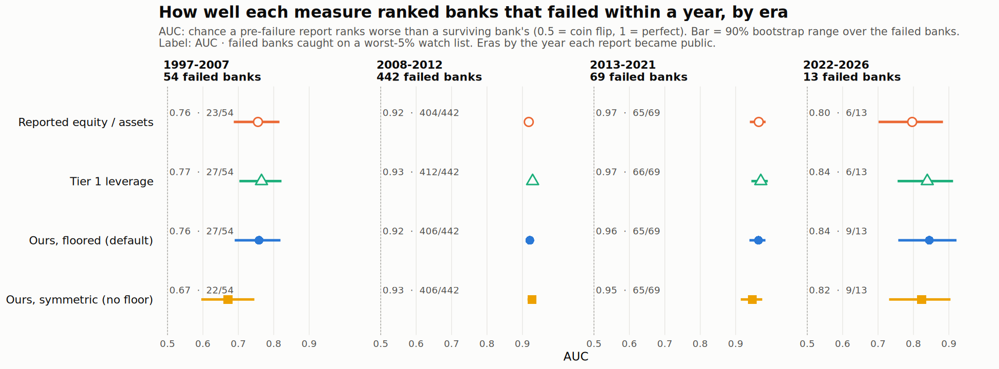

# Backtest: does "equity after hidden losses" find failing banks earlier?

**Short answer.** Only in the rate era. Over 1997-2026 (542 failed banks
scored), our score does about as well as plain reported equity in every
era, and the regulators' Tier 1 leverage ratio does slightly better.
2022-2026 is the one era where ours comes out ahead: 9 of 13 failures on the
worst-5% list vs 6. With only 13 failures, though, that lead can't be told
apart from luck. In the 2008-2012 crisis the score adds essentially nothing.
That was expected, because those failures came from credit and real-estate
losses, not from rates.



## How the model works (the 3-4% vs 7% idea)

A bank that made a 30-year mortgage at 3% in 2021 still collects 3%. By late
2022 new mortgages paid about 7%, so the old loan is worth less than its face
value, while the books still show face value. That gap is a *hidden loss*.
The estimator (now `pipeline/R/hidden_loss.R`) adds two of them,
for every bank and every quarter:

1. **Bonds held to maturity**: the loss read straight off the Call Report
   (fair value vs book).
2. **Loans**: an estimate. The rate gap is the mortgage rate minus the
   bank's own loan yield. Each slice of loans, grouped by years until it
   matures or reprices, loses gap × duration.

**Our score** is (equity − hidden losses) / assets. Low is bad.

## How far back, and how it is tested

- **The data starts in 1997Q2.** That is the first quarter in which the FDIC
  API has the loan maturity buckets (measured on every filer by the
  `research_field_coverage` mart). Fair values start earlier, around
  1994-95. We score 118 quarters, 1997Q2 to 2026Q3: 807,505 bank-quarters.
- **A gap before 2012.** Savings institutions that filed the OTS Thrift
  Financial Report (about 10% of banks and 17% of loans, including WaMu,
  IndyMac and World Savings) have neither the loan buckets nor HTM fair
  values in the API. The mart gives them an NA estimate with a reason, and
  they are left out of *every* score, so the comparison stays like-for-like,
  but their failures (305 pre-failure reports) could not be scored. Since
  2012 all banks file the Call Report and the gap is gone.
- **Same rules as before.** A report counts as public 45 days after quarter
  end. A "hit" is a failure within 1 year after that. Reports that only
  became public after the bank had failed are thrown out. FDIC "assistance"
  deals count as failures, and a bank that kept filing after one is labeled
  report by report.
- **Eras** are set by the year a report became public. A bank whose last
  4 reports straddle an era boundary counts in both eras.
- **Metrics.** AUC is the chance that a pre-failure report ranks worse than
  a surviving bank's report (0.5 = coin flip). *Caught* means the bank was
  on the worst-5% list in at least one of its 4 pre-failure quarters. The
  90% range resamples the failed banks, and comparisons are paired (same
  resample for every score). No fitted models.
- **Run time:** `analyze.R` takes about 15 s. It fetches nothing: the
  downloads below are the whole input.

## Results by era

AUC (90% range) and failed banks caught on the worst-5% list:

| Era | Failed banks | Reported equity / assets | Tier 1 leverage | **Ours, floored (default)** | Ours, symmetric |
|---|---|---|---|---|---|
| 1997-2007 | 54 | 0.76 (0.69-0.82) · 23 | 0.77 (0.70-0.82) · 27 | 0.76 (0.69-0.82) · 27 | 0.67 (0.60-0.75) · 22 |
| 2008-2012 | 442 | 0.92 (0.91-0.93) · 404 | 0.93 (0.92-0.94) · 412 | 0.92 (0.91-0.93) · 406 | 0.93 (0.91-0.94) · 406 |
| 2013-2021 | 69 | 0.97 (0.94-0.98) · 65 | 0.97 (0.94-0.99) · 66 | 0.96 (0.94-0.98) · 65 | 0.95 (0.91-0.98) · 65 |
| 2022-2026 | 13 | 0.80 (0.70-0.88) · 6 | 0.84 (0.76-0.91) · 6 | **0.84 (0.76-0.92) · 9** | 0.82 (0.73-0.90) · 9 |

Which differences are real (paired, in `summary.txt`):

- **2008-2012**, the only era with enough failures to settle anything. Ours
  beats reported equity by 0.003 AUC. That is real (in 100% of resamples)
  but far too small to matter. Tier 1 beats ours by 0.008, also real. Here
  the score is reported equity plus a little noise, as expected.
- **2013-2021.** The three capital measures are effectively tied. Tier 1 is
  ahead by under 0.01.
- **2022-2026.** Ours leads reported equity by 0.05 (in 82% of resamples)
  and Tier 1 by 0.01 (56%). Neither difference is proven.

## The falling-rate question: should hidden *gains* count?

Daniel's point: when rates fall, old loans at 5% become worth *more* than
new 3% loans, so banks can sit on hidden gains. The default score floors
the rate gap at zero, so it can never show a gain. The *symmetric* variant
drops the floor.

What happens without the floor (`summary.txt`, per quarter in `out/rate_gap_by_quarter.csv`):

| Period | Mortgage rate | Bank-quarters with a negative gap | Industry loan "gain", avg (worst) |
|---|---|---|---|
| 2008-2012 | 6.0% → 3.3% | 96% | 6% of equity (15%, $250 bn) |
| 2019-2021 | 4.3% → 3.1% | 99% | 13% of equity (17%, $378 bn) |
| 1997-2007 | 7.7% → 6.1% | 92% | 8% of equity |
| 2013-2018 (rates rising) | 3.6% → 4.6% | 94% | 4% of equity |
| 2022-2026 (rate era) | 4.2% → 6.9% | 35% | loss: +7% of equity |

**Decision: keep the floor as the default.** Three reasons:

1. **Most of the "gain" is not from falling rates.** The gap is negative for
   over 90% of banks in *every* era before 2022, rising-rate years included.
   A bank's loan yield sits above the mortgage rate mostly because of credit
   spread and loan mix (business, consumer and card loans pay more). That
   extra yield pays for expected losses. It is not a hidden asset. Without
   the floor, the riskiest lenders get the biggest equity boost.
2. **The backtest says so.** The symmetric variant is clearly worse in
   1997-2007 (−0.09 AUC, worse in 100% of resamples) and in 2013-2021
   (−0.02, 99.6%), and a bit worse in 2022-2026 (−0.02, 93%). It is better
   only in 2008-2012, by 0.006 (96%), a hair.
3. **Gains are hard to cash in.** Borrowers refinance when rates drop, so a
   premium mortgage gets prepaid at par, and a bank under stress rarely
   gets to sell at a gain.

So yes, Daniel is right that in falling-rate years banks were sitting on
paper gains, not losses, and a symmetric model would show it. It just
doesn't help spot failures. When the gap is floored, the score collapses to
reported equity in those years, which is the honest answer: no hidden rate
problem.

## 2022-2026 in detail

See `summary.txt` (per bank in `out/failed_bank_ranks.csv`; chart:
`failed_bank_ranks.png`). The main points:

- **First Republic** was in our worst 1% in all 4 quarters before it failed.
  Reported equity had it at 37-45%.
- **SVB** was in our worst 5% in 3 of its 4 quarters, and just outside it
  (5.3%) in its last one, 2022Q4. Reported equity had it at 9-29%.
- **Signature** was missed by every capital measure. Its problem was its
  depositors.
- **The fraud failures** are invisible to every score.
- **The 2026 small-bank failures** are caught by everything.
- **BTFP borrowing** is weakly predicted by every score (AUC 0.58-0.65).
  Of the 1,806 borrowers, 1,328 are FDIC-insured banks; the rest are mostly
  credit unions.

## What this does and doesn't prove

- **It does show** that the score does no harm across 30 years and ~540
  failures, and that it moves the two big rate-driven failures (SVB, First
  Republic) to the top of the list a year ahead.
- **It does not show** that we beat Tier 1. In every era with enough
  failures to tell, Tier 1 is at least as good.
- **Only one rate-driven episode exists in the data**, with 4 relevant
  failures. Nothing before 2022 can test the idea properly, because rates
  never rose fast enough while banks held long, low-yield loans.
- **Hindsight.** The method was designed by people who knew SVB failed.
- **Labels are thin.** Banks sold under stress count as survivors, the
  latest year's follow-up is not complete, and the API serves amended
  figures, not the originals.

## What changed when the backtest moved onto the marts (PR 7)

The findings above did not change. The estimator is now the pipeline's
(`pipeline/R/hidden_loss.R`), and the backtest reads its published output
instead of running a copy on its own downloads. Two fixes in the estimator
(spec traps 1 and 8, made in PR 5) move the numbers slightly:

- **Banks with zero or negative equity are kept.** The old estimator
  dropped them. They are often the banks about to fail, so 237 more
  bank-quarters are scored, and 82 more reports are now thrown out as
  "public after the bank failed" (they used to be missing). One more
  2013-2021 failure is scored (Millennium Bank, whose only pre-failure
  reports had negative equity): 69 failed banks, was 68. In 2022Q4, 21
  more banks are ranked, mostly below SVB, so SVB's last report moved from
  the worst 4.9% to 5.3%. It is still caught, on its three earlier reports.
- **Unreported is NA, not 0.** A bank with a missing loan bucket or fair
  value used to get a zero for it. It now has no estimate and drops out:
  2,349 more bank-quarters dropped (66,024 in all, 305 of them
  pre-failure, was 252). `summary.txt` lists the drops by the mart's
  `na_reason`. For the same reason the "buckets cover < 50% of loans"
  check now reads 0 for every year, and the thrift gap shows in its own
  column (no loan estimate: 11% of banks in 1997, under 0.5% since 2012:
  the insured branches of foreign banks).

Net effect: every AUC moves by 0.003 or less (the largest: reported equity
in 2022-2026, 0.799 -> 0.796; ours there 0.846 -> 0.845, which rounds the
table's 0.85 to 0.84). Every catch count is the same except 2013-2021,
which gains the one bank above. BTFP: borrowers now come from the committed
`pipeline/static/btfp.borrowers.csv`; 1,327 match a bank in the 2022Q4 panel
(was 1,316, matched the same way, on the 2022Q4 `RSSDID`: the difference
is the 21 banks the 2022Q4 panel gained).
The BTFP AUCs are within 0.003 of before.

## Files and how to run

`analyze.R` fetches nothing. It reads the `hidden_loss_history` and
`bank_ids` marts, each raw quarter's Tier 1 leverage ratio (`RBC1AAJ`, a
baseline score, not an estimator input), the FDIC failures list, and the
BTFP borrowers committed in `pipeline/static/` (one-time file, see
`pipeline/README.md`). "Observed so far" is the day the failures list was
pulled (`failures.manifest.csv`), not a typed-in date. A failure counts if
its `RESTYPE` is FAILURE or ASSISTANCE, from 1997 (the app's failures tab
uses FAILURE from 2000). From the repo root:
```sh
gh release download data-marts --dir pipeline/out/marts --pattern 'hidden_loss_history.parquet'
gh release download data-marts --dir pipeline/out/marts --pattern 'bank_ids.parquet'
gh release download data-raw   --dir pipeline/out/raw   --pattern 'risdate.*.parquet'
gh release download data-raw   --dir pipeline/out/raw   --pattern 'failures.*'
Rscript research/backtest/analyze.R   # summary.txt; CSVs to out/ (gitignored), ~15 s
Rscript research/backtest/chart.R     # auc_by_era.png, failed_bank_ranks.png
```
The settings (45-day lag, 1-year horizon, list sizes, era breaks, which
failures count) are at the top of `analyze.R`. The cause of each failure
since 2022 is typed in there (`CAUSE`); a new failure stops the script
until it is added. `out/` holds `era_metrics.csv`, `era_compare.csv`,
`rate_gap_by_quarter.csv`, `metrics.csv`, `failed_bank_ranks.csv`,
`failures.csv` and `btfp_2022q4.csv`.
