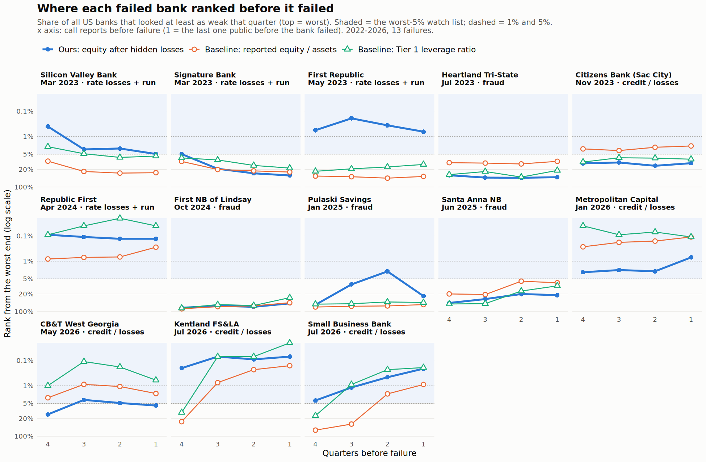

# Backtest: does "equity after hidden losses" find failing banks earlier?

**Short answer.** A little, and only for the kind of failure the score is
built for. Across all 13 US bank failures from 2022 to 2026, ranking banks by
equity after hidden losses beats ranking them by reported equity / assets
(AUC 0.85 vs 0.80), and it puts 9 of the 13 failed banks on a worst-5% watch
list vs 6. But the regulators' own Tier 1 leverage ratio scores almost the
same (AUC 0.84). With 13 failures, the gap between our score and Tier 1 is
indistinguishable from luck. Where the score does clearly help is the 4
failures driven by rate losses and deposit runs. It caught First Republic in
the worst 1% a full year before failure, while reported equity had it at
around the 40th percentile.

## How the model works (the 3-4% vs 7% idea)

A bank that made a 30-year mortgage at 3% in 2021 still collects 3%. By late
2022 new mortgages paid about 7%. Nobody would pay full price for the old 3%
loan when a new one pays 7%, so the loan is worth less than its face value.
The bank's books usually still show it at face value. That gap is a *hidden
loss*.

The estimator (`research/unrealized-losses/`, unchanged) adds up two hidden
losses for every bank, every quarter:

1. **Bonds held to maturity.** Banks report what these would sell for, so
   this loss is read straight off the Call Report.
2. **Loans.** These are estimated. The gap is the mortgage rate minus the
   bank's own loan yield. Each slice of loans, grouped by years until it
   matures or reprices, loses value by gap × duration: a loan that resets in
   3 months barely moves, and a 15-year loan moves a lot.

**Our score** is (equity − hidden losses) / assets: how thick the cushion
would be if the bank had to mark everything to today's prices. Low is bad.
The *calibrated* variant scales the loan loss up or down so that the same
method, run on bonds, matches their reported losses.

## What we tested

- **Banks and dates.** Every FDIC-insured bank in every quarter from 2021Q4
  to 2026Q3: 20 quarters, 90,578 bank-quarters. Every score is computed on
  exactly the same bank-quarters. 1,094 were dropped (no domestic deposits or
  no Tier 1 ratio), and none of them were pre-failure reports.
- **What counts as a "hit".** A report counts as a warning only if the bank
  failed within 1 year after the report became public. We assume a report is
  public 45 days after quarter end. A report that only became public after
  the bank had already failed is thrown out (3 such reports).
- **The failures.** The FDIC failures API lists 13 failures in the window,
  all outright failures with no assisted deals. The causes come from regulator
  and Inspector General reviews, listed in `failures.csv`:

| Bank | Failed | Cause | Group |
|---|---|---|---|
| Silicon Valley Bank (24735) | 2023-03-10 | Uninsured run after securities losses | rate + run |
| Signature (57053) | 2023-03-12 | Contagion run; poor management | rate + run |
| First Republic (59017) | 2023-05-01 | Uninsured run; low-rate mortgage losses | rate + run |
| Heartland Tri-State (25851) | 2023-07-28 | CEO wired funds to a crypto scam | fraud |
| Citizens Bank, Sac City (8758) | 2023-11-03 | Bad trucking loans | credit |
| Republic First (27332) | 2024-04-26 | Underwater HTM bonds; failed recapitalization | rate + run |
| First NB of Lindsay (4134) | 2024-10-18 | Falsified records, fraud | fraud |
| Pulaski Savings (28611) | 2025-01-17 | Missing deposits, suspected fraud | fraud |
| Santa Anna NB (5520) | 2025-06-27 | Hidden loan losses, suspected fraud | fraud |
| Metropolitan Capital (57488) | 2026-01-30 | Impaired capital, problem loan | credit |
| CB&T West Georgia (25796) | 2026-05-01 | Problem SBA loans (press reports only) | credit |
| Kentland FS&LA (28722) | 2026-07-10 | Losses, critically undercapitalized | credit |
| Small Business Bank (25744) | 2026-07-17 | Operating losses, critically undercapitalized | credit |

- **The scores compared.**
  - Baselines: reported equity / assets, and the Tier 1 leverage ratio.
  - Ours: adjusted equity / assets, base and calibrated.
  - Ours + uninsured: the rank on adjusted equity plus the rank on uninsured
    deposit share.
  - Control: reported equity rank + uninsured rank. This shows whether any
    gain comes from our adjustment or just from the uninsured share.
- **The metrics.** Each quarter, every bank gets a percentile from the worst
  end. *AUC* is the chance that a pre-failure report ranks worse than a
  random surviving bank-quarter (0.5 = coin flip). *Watch list* means being
  in the worst 1% or 5% in at least one of the 4 quarters before failure. No
  fitted models.

## Results

| Score | AUC (90% range) | Rate+run failures only (4) | Caught, worst 1% | Caught, worst 5% | Surviving banks wrongly on the 5% list |
|---|---|---|---|---|---|
| Reported equity / assets | 0.80 (0.70-0.89) | 0.80 | 5 / 13 | 6 / 13 | 616 |
| Tier 1 leverage | 0.84 (0.76-0.92) | 0.91 | 5 | 6 | 741 |
| **Ours, base** | **0.85 (0.76-0.92)** | 0.94 | **6** | **9** | 626 |
| Ours, calibrated | 0.82 (0.73-0.90) | 0.91 | 4 | 8 | 663 |
| Control: reported equity + uninsured | 0.69 | 0.97 | 3 | 4 | 681 |
| Ours + uninsured | 0.70 | **0.99** | 4 | 5 | 678 |

A random list would catch about 0.5 failures at 1% and 2.4 at 5%. The full
tables are in `summary.txt` and `metrics.csv`. Each failed bank's ranks,
quarter by quarter, are in `failed_bank_ranks.csv` and in this chart:



What the chart shows:

- **First Republic** was in our worst 1% in all 4 quarters before failure.
  Reported equity had it at 37-45%, and Tier 1 at 13-24%.
- **SVB** was in our worst 5% in all 4 quarters, and in the worst 0.4% a year
  out. Reported equity had it at 9-28%.
- **Signature** is essentially missed by every capital measure. Ours had it
  at 5.0% four quarters out, which technically counts as "caught", but it
  had drifted to 35% by the last report. Its problem was its depositors,
  not its assets.
- **So the 9 vs 6 is softer than it looks.** Ours adds SVB, First Republic,
  Signature (borderline) and Pulaski (likely chance), and it loses Citizens
  Bank, which reported equity caught (worst 2.4%).
- **Republic First** is caught by every measure. Its reported equity was
  already thin.
- **The fraud failures** (Heartland, Lindsay, Santa Anna) are invisible to
  every score, as expected. Ours did flag Pulaski (worst 2.5%), but that is
  probably a coincidence: it was a savings bank holding old low-rate
  mortgages.
- **The 2026 small-bank failures** are caught by everything, because their
  equity was visibly collapsing. Tier 1 usually sees them first.
- **Adding the uninsured share** makes the rate+run failures almost perfect
  (AUC 0.99). But the control with *reported* equity gets 0.97, so most of
  that comes from the uninsured share itself. It also hurts badly on the
  small failures, which had few uninsured deposits.
- **The binary run-risk flag** (adjusted equity < 0 and over 50% uninsured)
  flagged 20 banks over 20 quarters. 3 of them failed: SVB, First Republic
  and Republic First.
- **Secondary outcome, BTFP borrowing.** We matched the Fed's borrower list
  to banks exactly by RSSD ID, with no name matching. 1,316 of 1,806 borrowers
  matched, and the unmatched ones are nearly all credit unions and
  foreign-bank branches. Against who borrowed, every score is weak, with AUC
  0.58-0.65, and ours is no better (0.63 vs 0.62). That is not surprising:
  late in the program, many healthy banks borrowed because the rate was
  cheap. See `btfp_2022q4.csv`.

## What this does and doesn't prove

- **It does show** that the adjustment moves the two big rate-driven
  failures (SVB, First Republic) from "unremarkable" to the top of the list
  4 quarters ahead, using only data that was public at the time.
- **It does not show** that we beat regulators. Our score beat Tier 1 in
  only 56% of bootstrap resamples, which is a coin flip. It beat reported
  equity in 80%, which is suggestive but not proof.
- **Four failures of the targeted kind is an anecdote, not a sample.** One
  bank more or less changes the AUC by several points.
- **There is hindsight in the method.** The durations and the "3-4% vs 7%"
  framing were built by people who knew SVB and First Republic failed. A
  clean test needs data the method has never seen.
- **Labels are thin.** Banks sold under stress (PacWest, for example) count
  as survivors. The last 4 quarters (2025Q4-2026Q3) do not yet have a full
  year of follow-up, but restricting to complete windows changes AUCs by
  only about 0.02. The FDIC API also serves the latest amended figures, not
  the originals.
- **The watch lists are mostly false alarms.** With a 5% list (about 225
  banks a quarter), about 600-700 banks that never failed were on it at some
  point. Failure is rare (0.06% of bank-quarters).

## Next step

Get more and better outcomes before adding any model features:

1. Add near-failures as labels: distressed mergers, PCA "undercapitalized"
   notices, and FDIC/OCC enforcement actions.
2. Run the same test on 2008-2012, about 450 failures, mostly credit-driven,
   as an out-of-sample check that the score at least does no harm there.

## Files and how to run

From the repo root:
```sh
Rscript research/backtest/01_fetch.R     # FDIC (21 quarters), failures, FRED, BTFP -> cache/ (gitignored)
Rscript research/backtest/02_backtest.R  # all metrics -> summary.txt, *.csv
Rscript research/backtest/03_chart.R     # failed_bank_ranks.png
```
The estimator itself now lives in `research/unrealized-losses/estimator.R`
and is sourced unchanged. Its own outputs are byte-identical after the
refactor. Settings (45-day lag, 1-year horizon, list sizes) are at the top
of `02_backtest.R`.
